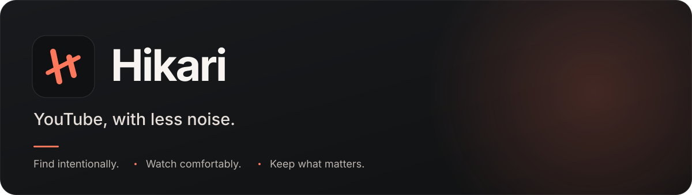
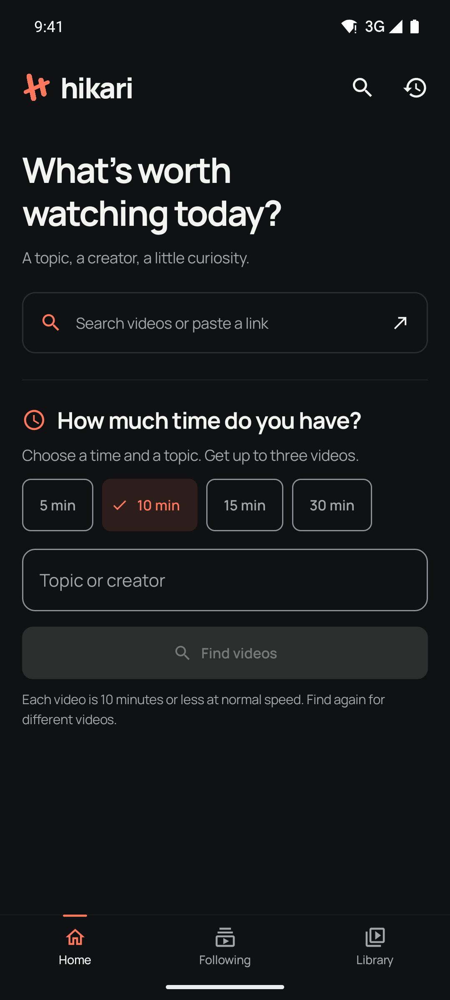
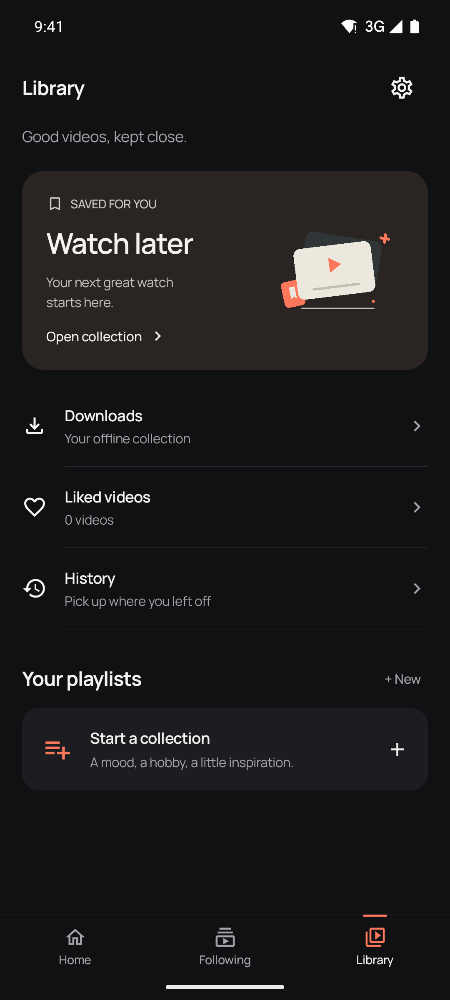
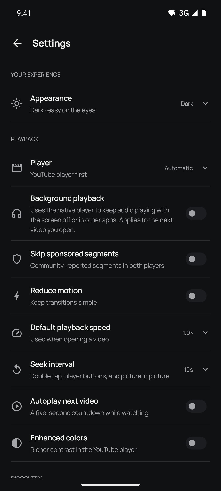
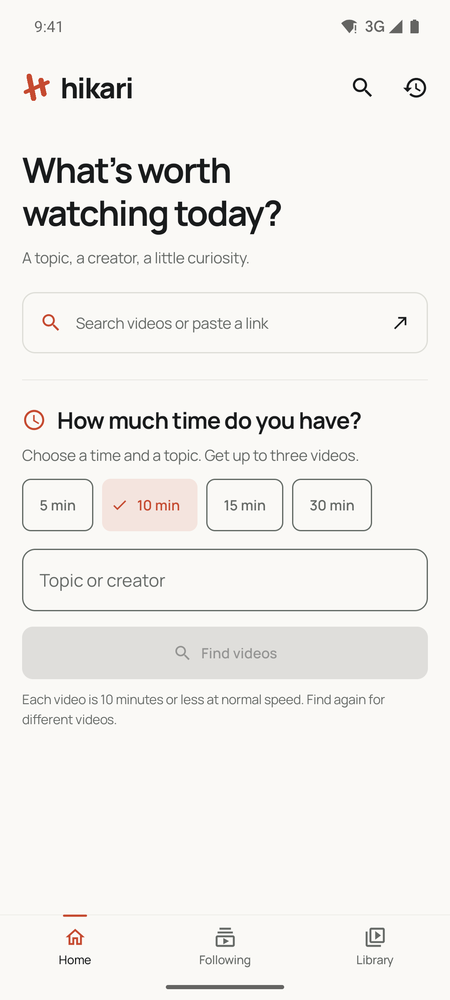

<p align="center">
  
</p>

<p align="center">
  A focused Android app for finding, watching, and keeping videos worth your time.
</p>

<p align="center">Android 8.0+ · No Google account · No root · No API key</p>

<p align="center">
  <a href="https://github.com/ah-REE/Hikari/releases/latest"><strong>Download Hikari for Android →</strong></a><br>
  <a href="#screenshots">Screenshots</a> · <a href="#install--update">Install guide</a> · <a href="#build-from-source">Build from source</a>
</p>

---

**Search for what you want. Watch it. Get back to your day.**

Hikari puts search, your creators, and your personal library first, with system, light, and dark themes and a calm interface throughout.

## Screenshots

<p align="center">
  <a href="docs/assets/screenshots/home-dark.png"></a>
  <a href="docs/assets/screenshots/library-dark.png"></a>
  <a href="docs/assets/screenshots/settings-dark.png"></a>
  <a href="docs/assets/screenshots/home-light.png"></a>
</p>

<p align="center"><strong>Home · Library · Settings · Light theme</strong></p>

Captured from **Hikari 1.0 on Android 15**. Click a screenshot to view it full size. The Home screenshots show the optional time-fit finder enabled.

## Make it your own

| | What you can do |
|---|---|
| **Find your next video** | Search, paste a YouTube link, or browse creator uploads in Following. |
| **Watch your way** | Use the mini-player, fullscreen, picture in picture, playback speed, and captions where available. |
| **Keep what matters** | Resume watching, save to Watch later, make playlists, and keep local likes and history. Export a JSON backup from Settings. |
| **Take videos offline** | Queue downloads, choose quality/audio language where available, and pause or resume transfers. |
| **Choose your extras** | Optional SponsorBlock segment skipping and estimated dislikes. The time-fit finder suggests videos within a 5, 10, 15, or 30 minute limit; it is off by default. |

Likes, follows, and playlists stay local—they do not sync with a Google account. Comments are read-only.

### Want to listen with the screen off?

Turn on **Settings → Background playback**. Background audio is **off by default**. Enabling it immediately switches the current video to the native player and locks the player choice to Native while the setting is on. Native playback continues with system media controls when Hikari is hidden.

Playback normally starts with YouTube's embedded player, with a native fallback. Video restrictions and upstream changes can affect playback, captions, and downloads; not every video will be available.

## Download Hikari 1.0.3

Open the [**Releases page →**](https://github.com/ah-REE/Hikari/releases/latest) and download **`Hikari.apk`**. It is the signed, ready-to-install version for everyday use.

`Hikari-debug.apk` is available for testing. `Hikari-SHA256SUMS.txt` contains checksums for both APKs.

### What you need

- **Android 8.0 / API 26 or newer.**
- **An up-to-date, maintained WebView provider** for embedded playback: Android System WebView or Chrome, depending on your Android version/device. You do not need both.
- **Internet** for search, streaming, downloads, and optional services. Downloaded media can play offline, but metadata and services can still access the network when connected.
- **Free storage** for the app and any media you download.
- **Permission to install the APK** from your browser or file manager; see below. No Google account, root access, or API key is required.

## Install & update

1. Open the [Releases page](https://github.com/ah-REE/Hikari/releases/latest) on your Android device and download **`Hikari.apk`**.
2. Open the APK. If prompted, temporarily allow **Install unknown apps** for the browser or file manager opening it.
3. Install Hikari, then turn that installation permission off again.
4. On **Android 13+**, allow notifications if offered and you want download/media status notifications. This is not required for playback.

**Updating a signed release?** Install the new signed release APK over your existing app—no uninstall is needed. The release uses the existing release key, so compatible signed-release updates retain your data. Exporting a JSON backup in Settings is still a good precaution.

**Coming from a debug or differently signed build?** All variants use the same package ID, `com.hikari.app`, so they cannot be installed side by side. A different signing certificate blocks an in-place update. **Export a JSON backup before uninstalling** the conflicting build, then install the signed release and import your backup in Settings.

Uninstalling removes app-private data, including downloads and settings. **JSON backups include library data, history, and settings—not downloaded media.**

## Build from source

You need **JDK 21**, **Android SDK Platform 36**, **SDK Build Tools 35.0.0**, and internet access for Gradle and its dependencies. Android Studio is optional. Set `ANDROID_HOME`, or set `sdk.dir` in a local `local.properties` file to your Android SDK path.

From the repository root, use the included Gradle wrapper—no global Gradle installation is needed:

```sh
./gradlew :app:assembleDebug
```

Your debug APK is at `app/build/outputs/apk/debug/app-debug.apk`. On Windows, use `gradlew.bat` instead of `./gradlew`. The private release signing key is not included in the source.

[Build, testing, and architecture guide →](docs/PROJECT_GUIDE.md#build-and-test)

## Your data & privacy

Your library and settings are stored on your device. Android automatic backup is disabled; use Settings to export your own JSON backup. Hikari has no account backend or app analytics SDK.

Search and playback contact YouTube/Google, including image hosts; embedded playback uses WebView networking, cookies, and storage. When enabled, SponsorBlock and dislike-estimate services receive video IDs and your network address. Offline media does not make the rest of the app network-free.

[Data and network details →](docs/PROJECT_GUIDE.md#data-and-network)

---

[GPL-3.0-or-later](LICENSE.md) · [Third-party notices](THIRD_PARTY_NOTICES.md)

Independent of Google, YouTube, and Team NewPipe.
